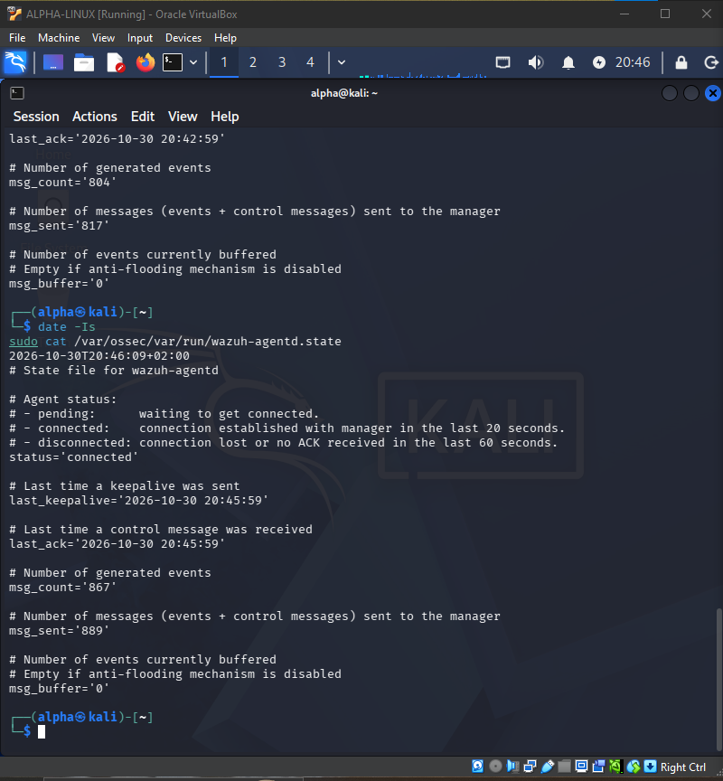
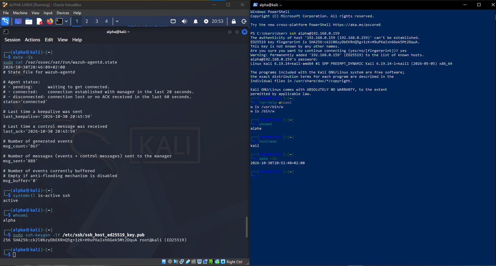
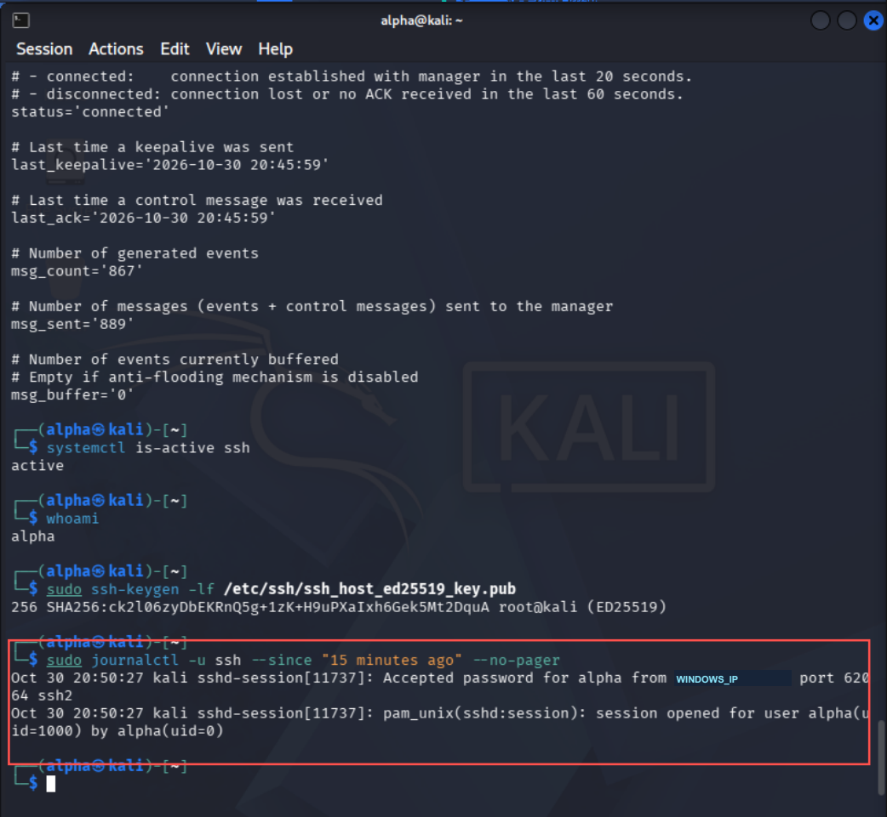
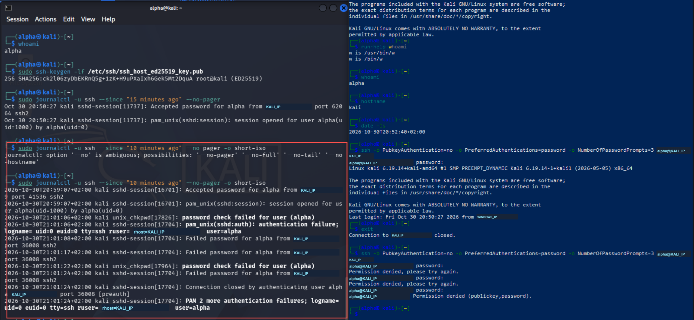
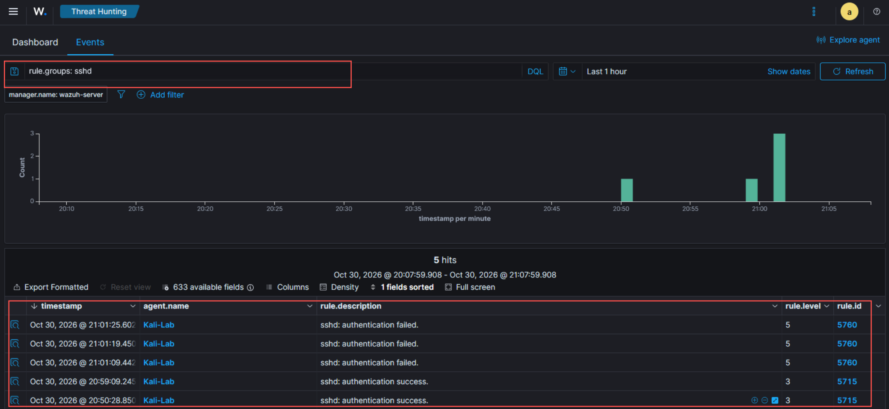
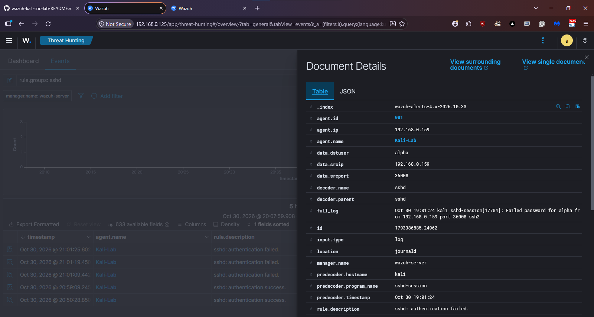
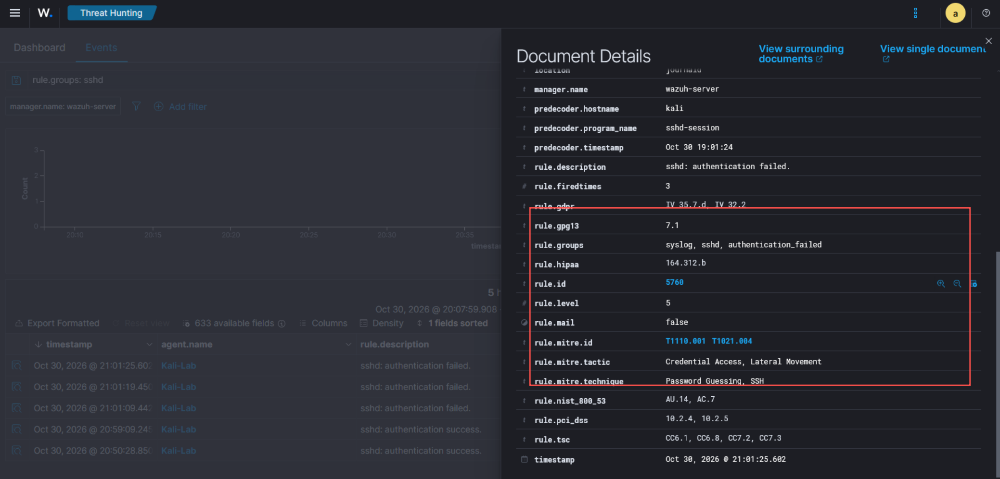
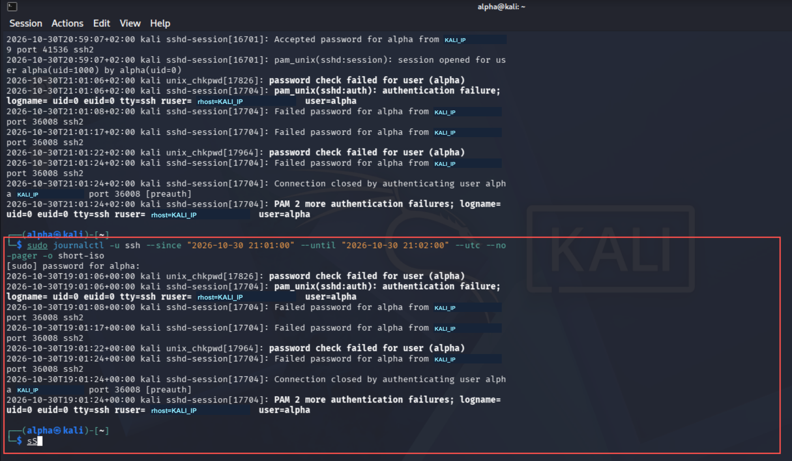

# 🛡️ Investigating Failed SSH Logins with Wazuh

A guided beginner SOC investigation using Kali Linux authentication logs and Wazuh alerts. This is a separate project from my earlier file integrity monitoring lab.

## 📌 At a glance

**Focus:** authentication log analysis · Wazuh alert triage · source attribution · timestamp correlation.

**Result:** three controlled failures were traced to one self-originated SSH connection. The evidence supports a lab test, not a claim of compromise.

[Findings](#-findings) · [Verdict and limitations](#-verdict-and-limitations) · [Evidence](#-evidence)

## 🎯 Objective
Generate controlled SSH authentication activity, correlate Linux logs with Wazuh alerts, and explain the outcome using evidence.

## 🧰 Environment
- Windows host with VirtualBox; Kali Linux endpoint with OpenSSH and Wazuh agent
- Wazuh v4.14.7 appliance; agent name: Kali-Lab
- Kali: KALI_IP; manager configured as WAZUH_IP
- Existing bridged networking was used. Host-only isolation was discussed but not implemented.

## 🔎 What I did
1. Verified SSH and the Wazuh agent were active.
2. Found that an active agent initially had a pending manager connection. After starting the Wazuh VM, confirmed connected status.
3. Established a successful SSH login from Windows (source WINDOWS_IP).
4. Made another successful login accidentally, then generated three deliberately incorrect password attempts.
5. Investigated journald records and searched Wazuh Threat Hunting using `rule.groups: sshd`.
6. Compared source IP, username, source port, process ID, rule details and timestamps.

## 📊 Findings
| Activity | Evidence |
|---|---|
| Successful logins | Two Wazuh rule 5715 alerts, level 3 |
| Failed logins | Three Wazuh rule 5760 alerts, level 5 |
| Failed-login source | KALI_IP, the Kali endpoint itself |
| Target account | alpha |
| Connection evidence | Process 17704 and source port 36008 shared across failures |
| Time window | 30 October 2026, 21:01:08-21:01:24 +02:00 |
| UTC equivalent | 19:01:08-19:01:24 UTC |
| Outcome | Connection closed after the third failure |

The failed test originated on Kali itself, rather than directly from Windows. I identified this from the logs and documented it rather than claiming a separate attacking host.

## 📝 Verdict and limitations
Expected controlled lab activity. The three failures occurred in one SSH connection over 16 seconds. These records alone show no successful compromise; they do not prove a brute-force attack. Earlier successful logins should not be described as success following these failures.

Wazuh attached T1110.001 (Password Guessing) and T1021.004 (SSH), with Credential Access and Lateral Movement tactics. These are rule mappings, not proof of malicious intent or lateral movement. PAM records may describe the same failures and must not be counted as extra attempts.

## 💻 Commands used

KALI_IP, WINDOWS_IP and WAZUH_IP are documentation labels, not literal command arguments. Replace <LAB_IP> with your own lab address.
```bash
whoami
ip -br address
systemctl is-active ssh wazuh-agent
sudo cat /var/ossec/var/run/wazuh-agentd.state
sudo grep -A 8 '<server>' /var/ossec/etc/ossec.conf
sudo tail -n 30 /var/ossec/logs/ossec.log
sudo ssh-keygen -lf /etc/ssh/ssh_host_ed25519_key.pub
sudo journalctl -u ssh --since "15 minutes ago" --no-pager -o short-iso
```

To compare UTC, add `--utc` to the journal command. The local journal time 21:01:24 +02:00 matched 19:01:24 UTC in the raw alert.

For a repeat test, use only your own lab host. In a client terminal, connect with SSH and enter three deliberately incorrect test passwords:
```text
ssh -o PubkeyAuthentication=no -o PreferredAuthentications=password -o NumberOfPasswordPrompts=3 alpha@<LAB_IP>
```
Record which machine the client command runs on. Check the host fingerprint locally before accepting a new SSH host key. Never publish passwords or agent keys.

## 📸 Evidence

Red boxes highlight relevant commands and evidence. Screenshots are cropped and private addresses are replaced with consistent labels: KALI_IP, WINDOWS_IP and WAZUH_IP. Untouched originals are retained locally.
















Screenshots derive from original lab evidence, with privacy redactions and explanatory boxes. Lab labels preserve correlation; no credentials are included.

## 💡 What I learned
- Service health and manager connectivity are separate checks.
- Source IP identifies origin; process ID and source port help correlate a connection.
- Timezone conversion prevents false timeline discrepancies.
- Alert labels require investigation and context.

## 🚀 Next improvement
Repeat with a clearly separate Windows client, record the source address before testing, and compare the evidence with this self-originated test.

## Acknowledgement
All activity was performed in my personal educational lab.

---

[← Security portfolio](https://github.com/KingAlpha362/KingAlpha362#-start-with-the-security-work) · [All projects](https://github.com/KingAlpha362/KingAlpha362/blob/main/PORTFOLIO.md)
